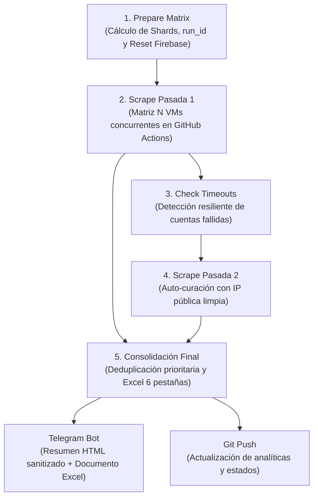

# 🛒 Alcampo Scraper & Live Monitor v3.0

> Sistema distribuido de alta concurrencia para la extracción, validación y monitorización en tiempo real de saldos y tarjetas de fidelización de Alcampo.

[](https://github.com/aandreistoica07-cmd/script-Alcampo/actions/workflows/alcampo_2pass_matrix.yml)
[](https://script-alcampo.vercel.app/)
[](tests/)

---

## 📌 Arquitectura del Sistema

El proyecto opera como un ecosistema desacoplado y resiliente dividido en 4 capas principales:

```text
script-Alcampo/
├── .github/workflows/       # Pipeline CI/CD 2-Pass Matrix en GitHub Actions
├── dashboard/               # Frontend PWA responsivo desplegado en Vercel
│   ├── index.html           # Panel en tiempo real (monótono [0, 100]%, sin VMs zombis)
│   ├── css/style.css        # Diseño Mobile-First con temas oscuros y tarjetas QR
│   └── manifest.json        # Configuración de Progressive Web App
├── scraper/                 # Motor de scraping headless de alta evasión
│   ├── script_optimizado.py # Motor Selenium con hidratación profunda y anti-falso 0
│   └── account_cooldown_manager.py # Cooldown adaptativo de 5 días para fallos recurrentes
├── scripts/                 # Utilidades CLI y orquestación
│   ├── local_test.py        # Sub-script independiente para pruebas locales
│   ├── prepare_matrix.py    # Cálculo de shards dinámicos e inicialización atómica en Firebase
│   ├── merge_and_retry.py   # Consolidación multi-hoja Excel y notificaciones Telegram
│   └── server.py            # Servidor HTTP local para desarrollo
└── tests/                   # Suite de 263 pruebas automatizadas (unitarias, adversarias y E2E)
```

---

## 🚀 Flujo de Ejecución Distribuido (2-Pass Matrix)

El pipeline de GitHub Actions se ejecuta automáticamente a diario a las **05:30 UTC (07:30 AM España)** o bajo demanda (`workflow_dispatch`):



---

## ⚙️ Configuración de GitHub Secrets

Para ejecutar el pipeline en GitHub Actions con **minutos ilimitados y gratuitos** (repositorio público seguro), configura los siguientes secretos en **Settings $\rightarrow$ Secrets and variables $\rightarrow$ Actions**:

| Secret | Descripción | Ejemplo / Formato |
|---|---|---|
| `ACCOUNTS_BASE64` | Cadena en Base64 con el array JSON de cuentas | `W3siZW1haWwiOiAidXN1YXJpb0BleGFtcGxlLmNvbSIsICJwYXNzd29yZCI6ICJQYXNzMTIzISJ9XQ==` |
| `TELEGRAM_TOKEN` | Token del bot de Telegram | `8041531688:AAHif8qa...` |
| `TELEGRAM_CHAT_ID` | ID del chat o grupo de Telegram | `-5049278431` |
| `FIREBASE_DB_URL` | *(Opcional)* URL de Firebase Realtime Database | `https://monitor-alcampo-default-rtdb.europe-west1.firebasedatabase.app/` |

> [!NOTE]
> Para generar tu valor de `ACCOUNTS_BASE64` desde un archivo `accounts.json` local en PowerShell:
> ```powershell
> [Convert]::ToBase64String([System.IO.File]::ReadAllBytes("scraper/accounts.json")) | Set-Clipboard
> ```

---

## 🧪 Pruebas y Desarrollo Local

### 1. Probar Cuentas con `scripts/local_test.py`
Permite comprobar credenciales en tu máquina sin necesidad de correr GitHub Actions ni configurar Firebase:

```bash
# Probar una cuenta individual en modo visible (headful) para depuración visual
python scripts/local_test.py --email "micuenta@ejemplo.com" --password "MiClave123" --visible

# Probar un lote de cuentas desde un archivo JSON en modo headless
python scripts/local_test.py --input-file "scraper/accounts.example.json" --headless --output-excel "resultado_local.xlsx"
```

### 2. Levantar el Dashboard en Local
```bash
python scripts/server.py --port 8085
```
Abre en tu navegador `http://localhost:8085/` para interactuar con el dashboard y el catálogo de tarjetas digitales.

### 3. Ejecutar la Suite de Pruebas
```bash
pytest tests/ -v
```
Ejecuta las **263 pruebas automatizadas** que validan la consolidación, el cálculo de progreso, la sanitización de Telegram, la eliminación de falsos saldos a 0 y la suite E2E completa.

---

## 🌐 Despliegue en Vercel

El dashboard está configurado para desplegarse automáticamente en Vercel a través de [`vercel.json`](vercel.json):
- **URL Oficial en Producción**: [https://script-alcampo.vercel.app/](https://script-alcampo.vercel.app/)
- **Directorio de salida**: `dashboard/`
- **Características**: Adaptado a pantallas móviles, barra de progreso monótona acotada, filtrado de VMs inactivas por `run_id` y catálogo de códigos de barras / QR.
